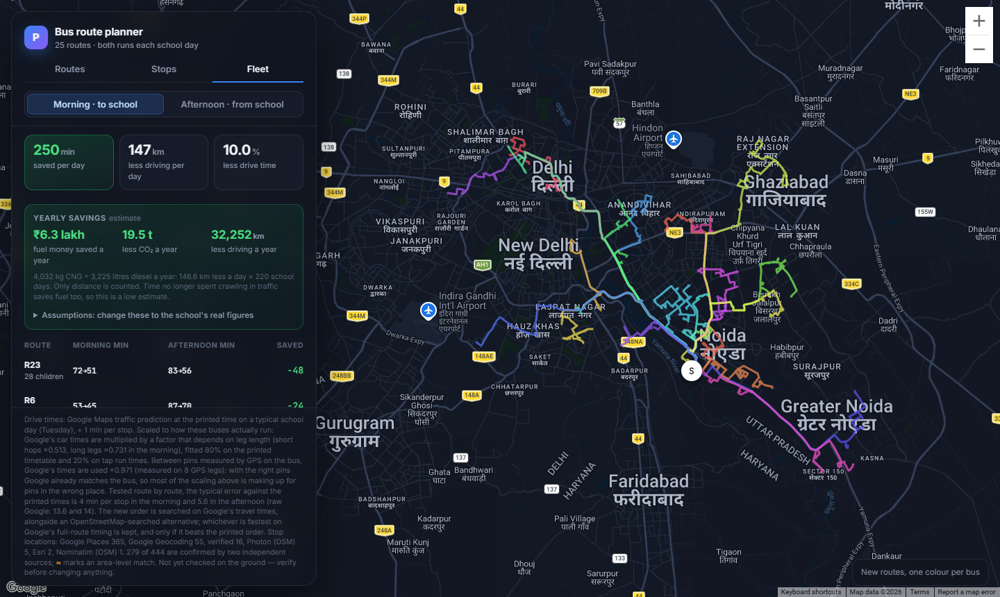
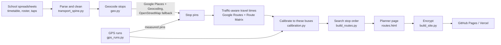

# School bus route optimiser

[](https://github.com/KidBossT/school-bus-route-optimiser/actions/workflows/tests.yml)

A data pipeline and route planner for the 23-bus fleet of Prometheus School, Noida.
It turns the school's spreadsheets (printed timetables, a student roster and 10,000
bus-card taps) into mapped routes, times them on Google's traffic predictions
calibrated to how these buses really drive, and proposes a faster stop order for
every run.

**Live planner:** [GitHub Pages](https://kidbosst.github.io/school-bus-route-optimiser/) ·
[Vercel](https://school-bus-route-optimiser.vercel.app/), password-protected
because it shows children's pickup points. Ask the owner for access.

**GPS tracker for bus staff:** [track.html](https://kidbosst.github.io/school-bus-route-optimiser/track.html),
open to anyone (it holds route names only), also linked from the password page.



## Results

On the 23 routes that run today (408 children, 46 morning and afternoon runs):

| | |
|---|---|
| Driving saved | **191 min a day**, 8.7% less drive time; 36 of 46 runs get faster |
| Distance saved | **109 km a day**, about 24,000 km a school year |
| Fuel money saved | **₹4.2–5.1 lakh a year** (all-diesel to all-CNG fleet)* |
| CO₂ avoided | **13–16 tonnes a year***|
| Timing model error | 14.1 → **3.6 min per stop** against the printed timetable (route-by-route cross-validation) |
| Checked against GPS | Google's times matched a GPS-logged bus run to **within 3%** (41.3 vs 40.1 min) |

\* Assumes 220 school days, CNG 4 km/kg at ₹85/kg, diesel 5 km/litre at ₹88/litre,
2.7 kg CO₂ per kg CNG and 2.68 kg per litre diesel. Only distance is counted. All of
these can be edited on the planner's Fleet tab. The screenshot's Fleet totals (250
min, 147 km) also count two routes that are not running this term.

## How it works



### The maths

- **Geocoding informal addresses** ("K-42 near Kwality store bazar"). Each word in a
  stop name is weighted by how rare it is across all 254 stop names, an inverse
  document frequency `log(N / (1 + df)) + 0.1`, so "metro" and "sector" count for
  almost nothing and a rare place name decides the match. A result must match 34% of
  the weighted name or it is rejected however confident the geocoder is. Distances
  use the haversine formula, and a pin counts as corroborated when independent
  sources agree within 300 m.
- **Stop order** is an open-path travelling salesman problem ending (morning) or
  starting (afternoon) at school. Runs of up to 13 stops are solved exactly with
  Held-Karp dynamic programming, O(n²·2ⁿ); longer runs use nearest-neighbour then
  2-opt. Travel times come from a sparse matrix: each stop to its 7 nearest stops on
  Google's traffic model, every other pair estimated at the run's median Google pace
  per straight-line km. Each stop is priced at the time the bus reaches it, and a
  proposal is kept only if Google's full-route timing confirms it is faster.
- **Calibration.** Google prices cars, not 40-seat buses stopping every few hundred
  metres. Each leg is scaled by a factor for its distance band (under 1, 1–2, 2–4,
  4–8, over 8 km), a ratio estimator fitted 80% on the printed timetable and 20% on
  observed tap times, then made non-decreasing with distance by the
  pool-adjacent-violators algorithm (isotonic regression). It is validated
  leave-one-route-out. Legs between GPS-measured pins use a separate factor fitted on
  GPS legs alone (0.97).
- **GPS runs.** A logged track is resampled to one point a second; a stop is the
  time spent inside a 25 m circle and its true position the median of those points.
  Stops are matched to the planned sequence by dynamic-programming alignment (like
  edit distance) with a penalty for skipped stops.
- **Measurement bias.** Morning card taps happen after the bus has left the stop, so
  they are late by an unknown lag. The analysis never fixes a value for it: the
  evidence dashboard recomputes every morning statistic live for any lag the reader
  picks. Times are reported as medians and p10–p90 ranges, always with the sample size.
- **Network optimiser** (built and tested, waiting for verified pins): a capacitated
  vehicle-routing solver with time windows: Clarke-Wright savings construction,
  relocate / swap / 2-opt / 2-opt\* local search, then ruin-and-recreate.

### GPS tracker (phone web app and Android app)

Bus staff log a run on their own phones, either in Chrome or in the **Bus GPS** Android app,
which is the same page wrapped with Capacitor. Before this, the free Android logger used for
the first run (GPSLogger) had left Google Play.

- **In the app** the GPS comes from a native foreground service (one high-accuracy fix a
  second, with a "recording this run" notification), so a run keeps recording with the
  screen locked or another app open: the didi can unlock, tap, and lock again. If the app is
  closed mid-run, opening it again carries on by itself. In Chrome the screen has to stay on.
- GPS starts when the page opens, so it has settled by the first stop; a stop tap waits up
  to 10 s for a fix within 20 m and otherwise takes the best one it saw.

- Records a continuous GPS track (`watchPosition`, high accuracy, about one fix a second)
  and one waypoint per stop from a large **BUS STOPPED / बस रुकी** button; English and Hindi labels.
- Keeps the screen on (Screen Wake Lock API), saves the run every 10 s so a closed tab
  or a crash can be resumed, and opens offline (a service worker caches the page).
- Filters fixes worse than 40 m and jumps faster than 130 km/h; detects Android's
  "approximate location" and a blocked permission, and says how to fix each.
- Writes the same GPX that `gps_runs.py` reads, with the route and session inside, and
  saves it on the phone as soon as the run is ended (app: `Documents/BusGPS/`, web page:
  Downloads). Nothing is sent from the phone: the IT team collects the phones and emails
  the files. A backup copy of the last 12 runs stays in the tracker itself.

**Tested** by replaying the real Route 11 GPS run through the page: the clean replay
reproduces every stop to within 1 s and 0.1 m. With phone-grade noise added (drifting
4 m error, 3% poor fixes, 0.5% 400 m jumps), all 8 stops and the school arrival are still
found, arrivals within 4 s, departures within 7 s, stop positions within 2–15 m. That
needed the stop detector hardened: a stop now ends only after 4 s outside its 25 m
circle, and a bus pulling forward up to 35 m at a gate stays one stop. Over 80
simulated noisy stops the departure error is 2 s typical, 3 s worst.

### Engineering

- Every Google call goes through one client that charges a monthly ledger before
  calling, stops at 80% of the free allowance, trips a circuit breaker on the first
  denial and falls back to free OpenStreetMap services. A normal month costs nothing.
- Google results expire from the cache after 30 days, as Google's terms require.
- The server key never reaches a web page; the pages use a separate browser key
  restricted to the site's addresses and the Maps JavaScript API.
- 38 unit tests, run on every push by GitHub Actions.

## Privacy

The school's spreadsheets, the student roster, the cache and every generated page
stay on the project computer and are not in this repository. The published planner
is encrypted with [StatiCrypt](https://github.com/robinmoisson/staticrypt)
(AES-256, key from the password by PBKDF2) and is excluded from search engines. No
student names or home locations appear anywhere in the planner; it shows stops only.

## Running it

Python 3.12 and `pip install -r requirements.txt`. The school's three workbooks go in
`inputs/` and a Google Maps key in `.env` (see [docs/TECHNICAL.md](docs/TECHNICAL.md)).

```bash
python pipeline/build_routes.py      # data, routes and outputs/routes.html
python pipeline/serve.py             # view it at http://localhost:8777
python pipeline/gps_runs.py R11_am_2026-10-14_0702.gpx.txt --apply-pins   # a tracker file
python -m unittest discover tests
```

### Android app

```bash
python pipeline/build_apk.py         # dist/bus-gps.apk, signed (needs JDK 21 + Android SDK 36)
```

`android-app/` is the Capacitor project (Capacitor 8, background-geolocation, share,
filesystem); the page inside it is built from `pipeline/track_template.html`, so the app
and `site/track.html` never drift apart. The signing key is created on the first build
outside the repository (`APK_KEYSTORE`, `APK_KEYSTORE_PASSWORD` in `.env`); every update must
be signed with it, so keep a backup. Installed by sending the APK on WhatsApp ("install
unknown apps" once per phone).

### Publishing

```bash
python pipeline/build_site.py        # encrypts the planner into site/ (needs Node.js)
```

Commit `site/` and push: a GitHub Actions workflow deploys it to Pages, and Vercel
redeploys from the same folder. The password and salt live in `.env` as
`SITE_PASSWORD` and `SITE_SALT`. The Google Maps browser key must list the site's
addresses under *Website restrictions*:
`https://kidbosst.github.io/*` and `https://school-bus-route-optimiser.vercel.app/*`.

## Layout

```
pipeline/
  transport_spine.py   spreadsheet parsers and audit log
  geo.py               geocoding and road times, provider-abstracted
  gmaps.py             Google client: usage caps, circuit breaker, 30-day expiry
  calibration.py       distance-band factors, isotonic fit, cross-validation
  build_routes.py      stop-order search and the planner page
  gps_runs.py          GPX ingestion, stop detection and alignment
  track_template.html  phone GPS tracker (track_assets/: offline cache, app icons)
  build_apk.py         the tracker as a signed Android app
android-app/           Capacitor project for the Bus GPS app
  build_site.py        encrypted copy for the web
  optimiser/           network-wide vehicle-routing solver
  routes_template.html planner front end (Google Maps, no framework)
tests/                 unit tests
site/                  the published planner (encrypted) and GPS tracker
docs/TECHNICAL.md      full design notes, constants and known limits
```
